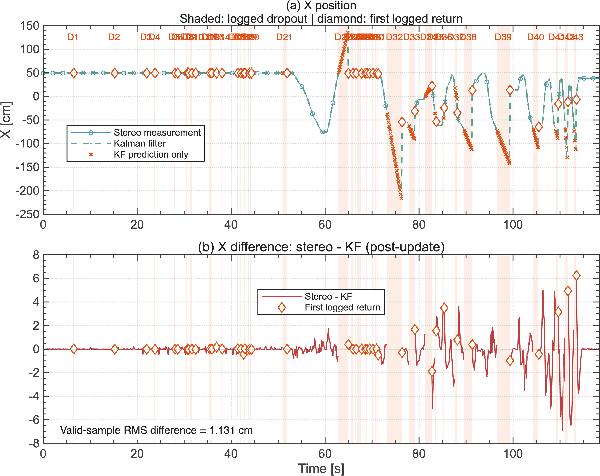
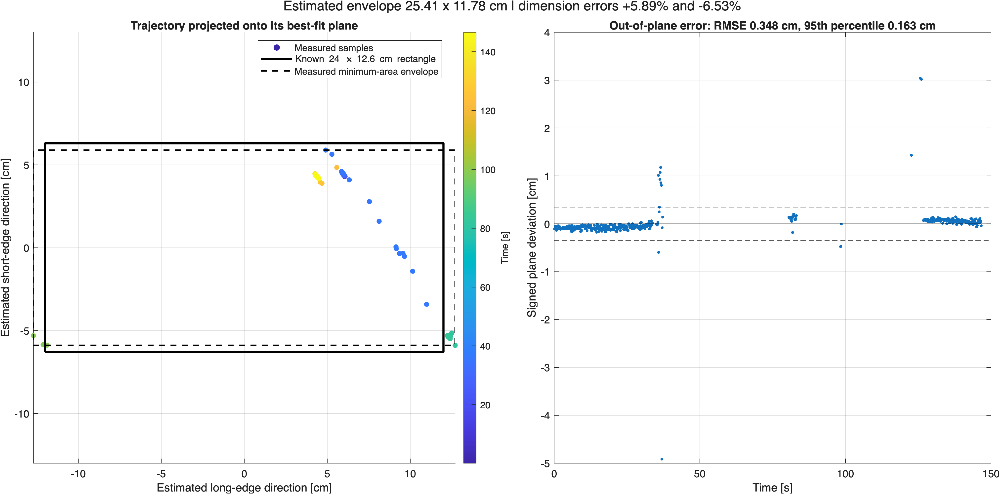
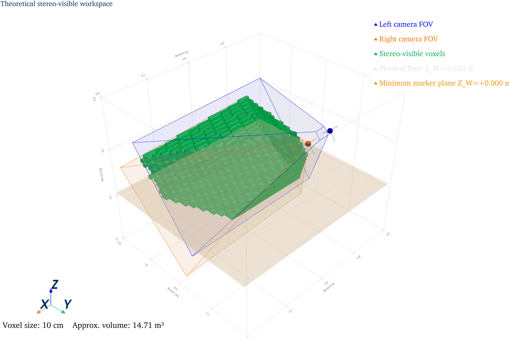

# Indoor Drone Tracking System

A selected portfolio of research code and results for indoor localization of a Crazyflie quadcopter with two cameras and a three infrared LED marker. The work covers stereo calibration, LED matching and triangulation, position and attitude estimation, constant velocity Kalman filtering, and experimental analysis.

This repository is a **curated snapshot** of the larger TH Rosenheim project. It keeps the main implementation, representative analysis code and data, and a few plots. It is not a complete hardware reproduction package.

## At a glance

| Area | Included work |
| --- | --- |
| Stereo vision | Bright blob detection, candidate matching, undistortion, triangulation, and marker geometry checks |
| State estimation | 3D position and ZYX orientation from the LED marker; six state constant velocity Kalman filter with prediction during detection loss |
| Calibration | ChArUco single camera and stereo extrinsic calibration scripts |
| Validation | MATLAB analysis of filter dropouts and a rectangular trajectory, each with a representative CSV log |
| Workspace | Camera field of view and visible voxel analysis |

## Results preview

| Kalman filter comparison | Trajectory analysis | Workspace estimate |
| --- | --- | --- |
|  |  |  |

Additional Y and Z filter plots are in [`figures/`](figures/). The plotted estimator differences show the effect of filtering; they are **not** ground truth localization errors. Recorded trajectories and workspace estimates reflect one experimental setup.

## Repository map

```text
python/attitude/       Main real time tracker and workspace analysis
python/calibration/    ChArUco calibration scripts
matlab/analysis/       Filter and trajectory validation scripts with sample logs
figures/               Selected output plots
requirements.txt       Python dependencies
```

## Reproducing the analysis

- `matlab/analysis/stereo/Linear_KF_analysis/KF_analysis10aug5.m` reads the CSV beside it and exports dropout and filter figures. It uses MATLAB R2020a or newer according to the script header.
- `matlab/analysis/stereo/rectangle_test/analyse_rectangle_trajectory.m` reads its accompanying CSV and analyzes the selected 10–130 second interval. It also needs MATLAB.
- Neither analysis requires the drone hardware. The CSVs are sample experiment logs; see the scripts for parameters and interpretation.

## Running the tracker

Create a Python environment and install the dependencies:

```bash
python3 -m venv .venv
source .venv/bin/activate
python -m pip install -r requirements.txt
```

On Windows, activate with `.venv\Scripts\Activate.ps1`.

The tracker requires two cameras, a Crazyflie/Crazyradio setup, and a **calibration file you generate for your own cameras** named `stereo_extrinsics_charuco.npz` in `python/attitude/`. The calibration scripts under `python/calibration/` show the ChArUco workflow; they expect captured images and their paths must be adjusted for your setup. Review camera indices, frame size, LED dimensions, axis corrections, and radio URI in the tracker before use. Then run from its own folder:

```bash
cd python/attitude
python triangle_tracking_tof_kf_integrated_10aug26.py
```

The workspace analysis also requires calibration data and uses PyVista; install `pyvista` separately if running it. Calibration arrays and captured images are not distributed in this portfolio snapshot.

## Scope and limitations

The code comes from experimental research and uses setup specific constants. Camera and radio workflows have not been verified on another machine. The two cameras are not hardware synchronized. The navigation frame is derived mainly from the camera frame, so camera to room alignment requires calibration for a new installation. The marker to body transform also needs calibration for precise sensor fusion. The Kalman filter uses a constant velocity model. The CSV logger samples less often than the filter runs, so short dropouts may not appear in the saved data.

Project attribution in the source material: **Mahendra Singh, Master's project/thesis, TH Rosenheim**. No repository wide license is granted here; existing rights and institutional policies apply. Third party templates, complete reports, and historical Git history are excluded from this portfolio copy.
